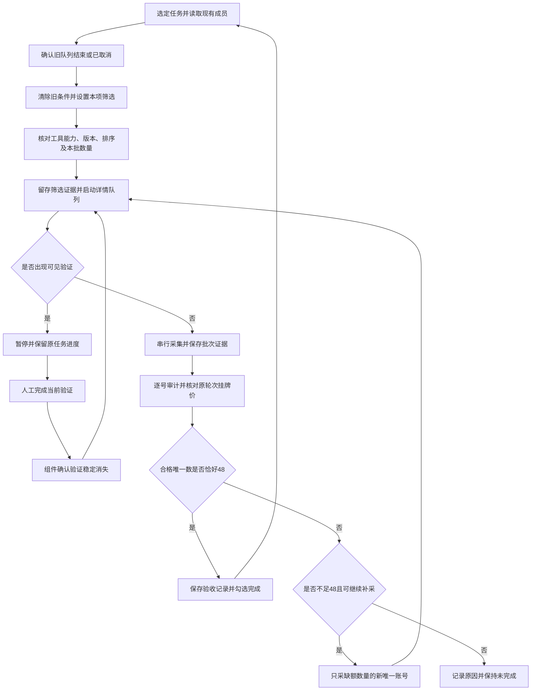

# 15 自动数据采集任务流程

> 定位：依据螃蟹鸣潮条件采集的实际经历，规定任务准备、扩展详情队列、验证恢复、精确补采及挂牌价验收流程。
> 日期：2026-10-06（Asia/Shanghai）。本次整理流程文档，不启动或续跑采集，不改变扩展配置和任务完成状态。
> 关联：[估值体系](12-鸣潮账号价值估算体系.md)、[验证恢复组件](13-访问验证中断恢复组件.md)、[条件任务清单](14-鸣潮条件采集任务清单.md)、[项目工作规则](10-工作规则.md)。

## 1. 流程目标及分工

当前鸣潮V2任务每项收集恰好48个合格唯一账号，采用详情页采集。挂牌价是指导价格、训练标签和验收标准；成交价值不在本流程验收范围。旧Y02、Y04映射为V2-Y03、V2-Y07，两批各64条保留历史验收，按清单跳过。

这里的自动采集指：任务条件和本批数量确认后，由既有扩展自动扩页、保存列表价格、串行打开详情、向本机网关入库并维护队列。网站验证和控制工具无法访问的扩展弹窗由人工接手。每个任务最终是否完成，须由成员审计和同轮次价格核对决定。

| 环节 | 执行责任 | 必须留下的结果 |
|---|---|---|
| 任务选择、条件配置、启动检查 | 操作者或助手 | 任务ID、条件版本、实际筛选及排序 |
| 扩页、列表及详情队列、入库 | 现有扩展与本机网关 | 批次、列表快照、原始详情、过程状态 |
| 可见访问验证 | 人工；助手仅按当前控制工具规则操作 | 等待状态、当前页面、恢复结果 |
| 完整性、条件、去重、价格轮次验收 | 已核实可用的离线审计工具与操作者 | 成员明细、排除原因、逐号入库核对 |
| 精确补采、清单更新 | 操作者或助手 | 当前缺额、独立补采批次、最终验收记录 |

## 2. 总流程



队列的“结束”只是进入审计的节点；验证恢复沿用原任务，补采则创建独立批次。超采不能经静默删选变成合格48条。

## 3. 启动前检查

### 3.1 选定任务与计算数量

1. 从清单选择一个任务，记录任务ID、完整条件、目标48和已验收成员ID。
2. 新任务首次批次设48条。补采设为`48−当前合格唯一账号数`，不以列表数、详情成功数或网关累计数计算缺额。
3. 核实历史完成映射，避免把旧样本重新计为新增。任务内同ID只算一个账号，跨任务重叠另行登记。
4. 配队列按T01至T06单队列逐项执行；用户明确调整执行顺序时，将调整记入清单。

### 3.2 确认真实运行状态

打开扩展弹窗查看队列状态、当前任务及进度。上一任务仍为`running`或`waiting_verification`时，先继续该任务，或明确取消并保留已采数据，再切换筛选。

**关闭“自动采集”仅关闭新的浏览自动启动，不等于取消运行中的详情队列。**修改采集模式或数量是下一任务设置，不能假定已有队列被改成了新数量。页面角标可能保留旧消息，网关`pending_details=0`也不能单独证明扩展空闲；以弹窗队列状态及相应批次记录核实。

确认本机网关可连接，目标只勾选本次游戏，数据库与原始数据目录正确。鸣潮当前使用`wuwa_official`路由；研究任务ID如`V2-T01`需在任务登记中单独关联，不能把所有鸣潮批次都算进同一研究任务。

### 3.3 确认工具及参数

| 项目 | 当前鸣潮V2执行口径 |
|---|---|
| 扩展加载版本 | 登记浏览器实际加载版本；已使用版本为0.5.4，不能只记录磁盘最新版本 |
| 采集方式 | 详情页采集 |
| 首批目标 | 48条 |
| 补采目标 | 当前缺额D条 |
| 详情间隔 | 0.4秒 |
| 自动采集开关 | 条件任务默认关闭，完成准备后点击“采集本页”启动自动队列 |
| 并发 | 一个任务、一个详情工作标签页，串行处理 |
| 排序 | 记录实际选中项；此前实跑使用综合排序 |

详情间隔与列表全文请求间隔独立，不能把其中一项的数值当作另一项生效。0.4秒是当前用户设定，既有经历没有证明它能消除访问验证，也没有证明每次验证由详情间隔造成。

工具能力必须在**实际执行路径**核实：开发工作树有脚本、单元测试通过，不等于运行目录已有该入口、浏览器已加载新扩展或该任务命令可运行。启动前确认本任务条件匹配、原轮次核对、跨批ID去重及固定48条验收均可用；不支持的条件登记“条件待核实”，不使用旧31项最低链数匹配器代验新版任务。

### 3.4 地址与工具入口

以下为2026-10-06核实的本机运行项目地址。执行时使用F盘运行目录，不把开发工作树中的同名文件当作已部署入口。网关端口若有调整，以扩展实际连接地址为准。

| 用途 | 地址或文件 | 使用方法 |
|---|---|---|
| 鸣潮列表源页 | [螃蟹鸣潮账号列表](https://www.pxb7.com/buy/10302/1) | 在已登录的Chrome会话中筛选；网址后的研究标记不设置筛选 |
| 采集看板 | [本机完整看板](http://127.0.0.1:8765/) | 查看连接、采集目标、批次和数据；扩展内也可点“完整看板” |
| 网关只读状态 | [status](http://127.0.0.1:8765/status)、[stats](http://127.0.0.1:8765/stats)、[config](http://127.0.0.1:8765/config) | 浏览器打开即GET查询；用于核对状态与设置，累计量不等于任务验收量 |
| 看板启动入口 | [采集看板.bat](<F:/deepseek workplace/pxb7-price-monitor/采集看板.bat>) | 网关未运行时双击；连接正常时无需重复启动 |
| 批次详情验收器 | [audit_wuwa_sampling_batch.py](<F:/deepseek workplace/pxb7-price-monitor/tools/audit_wuwa_sampling_batch.py>) | 在PowerShell中用项目Python运行，命令见7.1；它是离线脚本，没有独立网页地址 |
| 项目Python | [python.exe](<F:/deepseek workplace/pxb7-price-monitor/.venv/Scripts/python.exe>) | 避免用缺少项目依赖的其他Python解释器 |
| 扩展文件与版本 | [manifest.json](<F:/deepseek workplace/pxb7-price-monitor/extension/pxb7-extension/manifest.json>)、[popup.html](<F:/deepseek workplace/pxb7-price-monitor/extension/pxb7-extension/popup.html>) | 已有扩展目录为`extension/pxb7-extension`；磁盘版本0.5.4仍须与浏览器实际版本核对 |
| 原轮次数据库 | [pxb7.duckdb](<F:/deepseek workplace/pxb7-price-monitor/data/pxb7.duckdb>) | 原价入库核对数据源；离线详情验收器不会自动读取或修改它 |
| B01原轮次核对证据 | [网关快照核对-初批.json](<F:/deepseek workplace/pxb7-price-monitor/data/analysis/valuation/wuwa-20261006/condition-sampling/V2-B01/网关快照核对-初批.json>) | 仅证明B01初批对应48号的历史轮次与价格，不代替新批次核对 |

旧汇总工具[summarize_wuwa_sampling.py](<F:/deepseek workplace/pxb7-price-monitor/tools/summarize_wuwa_sampling.py>)读取旧31项登记并写出汇总台账，不能直接当作新版固定48条、跨补采批次的最终验收器。[verify_wuwa_valuation.py](<F:/deepseek workplace/pxb7-price-monitor/tools/verify_wuwa_valuation.py>)核验历史估值产物，也不是采集批次验收入口。

## 4. 配置筛选与保存证据

1. 清除上一任务留下的价格、黄数、角色、武器、配队、服饰及车辆条件。先确认旧队列已结束或已取消，再操作源页。
2. 固定公共条件为“鸣潮、账号、官服”。TAP与Wegame不额外限定，详情中如实记录。
3. 只填写当前任务规定的区间和精确选项，其他留空。区间包含上下端点，≥仅填下限；精确0须上下限均填0，空白不能表示0。
4. 多条件采用AND。配队必须全部三名成员拥有；不能把“有1个就行”当作完整配队。角色0链、1–2链和3–5链须有上界核验，不能只用最低链数。
5. 应用筛选后等待列表实际刷新，检查已选标签、输入值、公共条件和排序。刚关闭下拉框时可能仍显示上一批卡片，应确认新结果已经出现。
6. 保存筛选截图或可复核的已选标签记录，并登记源页URL、配置时间、扩展实际版本和首屏数量。URL中的研究标记仅用于追踪，不替代实际筛选证据。

热门配队标签可作为列表筛选入口，但不能替代详情成员AND核验。若平台不能可靠表达任务条件，记录限制并保持未完成，不扩大候选批次后再择优补数。

### 4.1 Chrome页面的具体操作

1. 切回已有Chrome中的鸣潮列表标签页。确认地址为`www.pxb7.com/buy/10302/1`，页面处于正常商品列表；先处理当前验证，再配置条件。
2. 旧队列结束或取消后，在游戏筛选区点击“重置筛选”。逐项查看区间输入和已选标签，确认旧黄数40–79、角色等残留确已清除。
3. 在“商品类型”选择“账号”，在“按操作系统”选择“官服”。“国际服”子选项及TAP、Wegame保持“全部”；按实际页面及详情核对官服，不能凭某个“全部”字样推定服务器已选对。
4. 在“区间筛选”输入任务值。该区包括价格区间、浮金波纹、铸潮波纹、星声、五星角色数量、黄数、月相、余波珊瑚和等级，每项都有“下限”“上限”。例如黄数40–79输入40和79；黄数≥100只输入下限100。B01所有区间均留空。
5. 在“精确选择”点击任务对应的“角色”“武器”“热门配队”“服饰”或“摩托外观”下拉框，搜索并选中目标；如有匹配方式，按任务选择“全部要有”，再点击“确认”。其他下拉框保持无已选项。角色链数的上下界仍须在详情验收，不能由拥有角色标签推断。
6. **T01示例**：点击“热门配队”→在“请输入热门配队关键词搜索”中输入“爱达千”→选中“爱达千”→选择“全部要有”→点击“确认”。闭合后应出现“热门配队+1”和“爱达千”标签；账号、官服保留，其他区间与精确选择为空。详情逐号核对爱弥斯、达妮娅、千咲全部拥有。
7. 等待列表实际刷新，再查看当前排序。此前实跑为“综合排序”；不把“最新发布”记录成已选排序。初始显示16张卡片属于首屏数量，扩展后续负责扩页。
8. 保存包含公共条件、区间、已选标签和排序的截图，例如`V2-T01-筛选-YYYYMMDDTHHMMSS.png`；把实际URL、时间、排序写入任务登记。下拉菜单遮挡输入时可分两张截图。

T02–T05在清单中分别对应“清达莫队”“绯琳莫队”“爱弥斯震谐队”“西仇守队”，执行时仍要核实网站当时提供的选项。T06的站点配队标签尚未确认；不能杜撰标签或拿相近队伍代替。若改用角色多选，必须现场确认三名角色与AND语义均能表达，否则登记待核实。

## 5. 启动及自动执行

打开pxb7采集助手，复核“详情页采集”、本批数量和0.4秒，保存后点击一次“采集本页”。控制工具不能访问扩展弹窗时，由用户从Chrome工具栏完成这一步；工具明确拒绝内部URL时，不尝试其他路径绕行。

扩展按目标数量尝试加载更多卡片，选择前N个唯一商品，先保存列表清单及挂牌价，再建立详情队列。首屏16条不等于总库存只有16条；能否加载到目标数量以实际扩页结果为准。

队列复用一个详情工作标签页，逐号等待详情就绪、核对商品身份并入库。弹窗关闭后队列可继续；源页条件保持不变，等待期间不重复点击启动、不另开并行任务。

监控时记录当前商品、`processed`、`succeeded`、`failed`、`incomplete`和状态。网关累计值只用于检查是否收到数据，任务数量须按本批成员计算。进度暂时不变时，先检查弹窗状态、可见验证、网络和批次更新时间，不能因此重启整批。

扩页不足、详情失败或缺字段时，登记实际数量及原因。扩展`done`、`partial`或“入库48条”均须进入下一节审计；扩展成功计数不等于模型合格数。

### 5.1 扩展弹窗的具体操作

1. 让**已经筛选好的鸣潮列表标签页成为当前活动页**。点击Chrome右上角拼图“扩展程序”，找到“pxb7 采集助手（前端 B）”；可点图钉固定，再点扩展图标打开。弹窗标题为“pxb7 采集看板”。从本机看板或某个详情页点击“采集本页”不会启动所需列表批次；在单详情页触发只采该号。
2. 检查顶部连接状态和版本。正常应显示“已连接”及更新时间。断开时先启动3.4的`采集看板.bat`；“启动网关”按钮仅在已安装本机启停组件时可用。重新打开弹窗确认连接，不以旧角标判定状态。
3. 查看“采集进度”。若显示“进行中”或“等待网站验证”，先处理现有队列。需要结束时点击“取消采集”，等状态确认为“已取消”，再换条件；已入库数据保留。不要用“停止服务”代替取消采集。
4. 在“采集目标（勾选要采集的游戏）”只勾选“鸣潮-官服”（路由`wuwa_official`），其他游戏取消勾选。研究任务`V2-B01`或`V2-T01`记录在任务登记，路由名不会自动区分这些条件任务。
5. “采集方式”选择“详情页采集”；取消勾选“自动采集”；“每次采集张数”首批填48、补采填缺额D；“详情采集间隔(秒)”填0.4。保持其他参数按已登记配置，不把“全文请求间隔(秒)”或“去重间隔(分)”当作详情间隔。
6. 点击“保存设置”，等待“设置已保存并生效 ✓”，复核模式、数量、间隔及目标。必要时查看3.4的`/config`确认生效；保存设置本身不代表采集已经启动。
7. 再确认活动标签页仍是本任务筛选列表，然后只点击一次“采集本页”。记录本次列表`run_id`、列表采集时间和原轮次；研究任务ID与本批`run_id`分开记录。扩展先扩页和保存列表，再进入详情队列。
8. 运行中可关闭弹窗，稍后点图标重新查看。“入库”“失败”“待补齐”与“已完成”“部分完成”等状态分别登记；不重复启动、不改源页筛选、不关闭详情工作标签页。结束后进入逐号验收。

补采时不能仅把数量改为D后从原列表顶部重跑，这可能仍采到已有成员。必须先确定D个未计入本任务的新唯一ID及其来源，再采用能够锁定这些ID的详情补采方式；如现有入口不能保证不重号，登记限制并保持未完成，不能扩大数量寻找备用候选。

扩展已安装时无需重装。若要应用扩展更新，应在队列结束或取消后进行，核对浏览器显示的新版本，再刷新源页；运行中的队列不要通过重载扩展来排障。控制工具无法打开弹窗时，人工按上述工具栏步骤接手。

## 6. 验证及异常恢复

| 现场情况 | 处理 | 恢复依据 |
|---|---|---|
| 可见滑块或访问验证 | 立即停止主动采集，保留原队列并提示处理当前页面 | 当前验证稳定消失后沿用原任务 |
| 验证页未消失 | 继续等待，不刷新施压、不跳过当前商品 | 仅等待时间过去不能作为恢复依据 |
| 网关拒收但页面看不到挑战 | 保存拒收原因，不持续重复提交 | 弹窗“验证已完成，继续”会再次检查实际页面 |
| 控件拖动无效 | 停止重复尝试，交由用户手动完成 | 用户处理后再核实页面恢复 |
| 连续网络失败、超时或暂停 | 保存已成功成员及失败ID，检查站点和网关 | 故障解除后按可核实状态继续或精确补采 |
| 页面换了条件、串号或结果来自旧任务 | 拒绝将结果计入当前任务，记录关联错误 | 原任务、商品ID、URL及轮次均正确 |
| 用户取消任务 | 保存已落盘数据及缺额，登记取消状态 | 后续启动独立补采批次 |

现有恢复组件保存`waiting_verification`状态及当前商品，验证不消耗该账号、不增加失败数；组件观察到验证稳定消失1秒后恢复。后台重启或刷新后的持久化恢复仍须核对任务和源页身份，不能把刷新当作常规排障手段。

此前助手拖动真实滑块曾未能移动控件，最终由用户手动完成。因此流程不承诺自动完成验证。若助手使用当前控制工具尝试滑块，遵守该工具对**当前挑战**的确认要求，不能沿用旧验证码的许可；禁止读取验证参数或绕过验证。

### 6.1 验证后的具体续采操作

1. 在扩展中确认“等待网站验证”，保留原列表和详情工作标签页。找到实际显示滑块的页面，不只检查源列表；详情工作页也可能出现验证。
2. 人工在可见滑块上按住鼠标，按网站提示拖至最右侧并松开，等待正常内容恢复。助手操作前须满足当前工具对本次挑战的确认要求；拖动无效就停止并由用户完成。
3. 保持页面不刷新、筛选不变，让组件观察验证稳定消失；若队列已自动恢复，继续观察原进度，无需再次启动。
4. 若仍显示“等待网站验证”，打开弹窗，点击出现的“验证已完成，继续”。该按钮会再检查实际页面；挑战还在时不能强行通过。
5. 确认队列恢复到同一任务、同一当前商品，进度随后继续推进。不要点击“采集本页”新建整批；如状态无法确认，保存现场和批次，维持未完成。

## 7. 逐号验收

每个账号须全部通过以下检查，才计入合格唯一数N：

1. **身份与条件**：商品ID一致，确为鸣潮官服账号；详情实值满足任务的全部区间、角色、武器、配队或外观条件。
2. **详情完整性**：角色、链数、武器、精炼及任务必需字段完整且可解析；角色人数、武器件数与具名清单交叉核对，黄数与链数、精炼份数关系按审计口径检查。未知不填0，不把宣传文字或推荐内容当作资产拥有。
3. **配队记录**：逐个确认指定三名队员，记录各自链数及可核实的对应专武、精炼；不限链数不等于不用记录链数。
4. **挂牌价**：原列表挂牌价为正数，详情和入库关联证据可复核。后来变价独立留存，不用新价替代旧列表标签以通过核对。
5. **原轮次入库**：数据库存在同ID、同原轮次、同原挂牌价、官服的快照。详情取得时间可以晚于列表，但必须绑定原列表轮次；分钟与秒格式比较前规范化，不能改动实际轮次。
6. **唯一性**：按商品ID跨本任务所有批次去重。同号多个快照只算一个任务成员，跨任务重叠单独统计。
7. **原始证据**：成员明细关联列表批次、原始详情文件、采集时间和SHA256；排除成员注明失败、缺失、重复、条件不符或错轮次等原因。

只查“最新快照”可能查不到原轮次。验收须查询对应历史轮次，或使用当时已保存的逐号核对证据，不能以当前价格相同推定历史轮次一致。

### 7.1 离线详情验收器的使用方法

在PowerShell运行下面的历史B01重放示例。它读取已经保存的原始文件，将新报告写入独立临时目录，不请求网站、不修改数据库，也不覆盖原验收记录。截止时间是该初批已登记的本地时间；新批次必须替换为自身的真实截止时间。

```powershell
$projectRoot = 'F:\deepseek workplace\pxb7-price-monitor'
$pythonExe = Join-Path $projectRoot '.venv\Scripts\python.exe'
$auditor = Join-Path $projectRoot 'tools\audit_wuwa_sampling_batch.py'
$listMeta = Join-Path $projectRoot 'data\raw\pxb7\wuwa_official\20261006\wuwa_official-plugin-20261006T174708-5691\list_p01.json'
$rawRoot = Join-Path $projectRoot 'data\raw\pxb7\wuwa_official\20261006'
$auditOutput = Join-Path ([IO.Path]::GetTempPath()) ('pxb7-b01-audit-' + [guid]::NewGuid().ToString('N'))
& $pythonExe $auditor --task V2-B01 --list-meta $listMeta --raw-root $rawRoot --ended-at '2026-10-06T17:51:08' --output $auditOutput
if ($LASTEXITCODE -ne 0) { throw '验收器执行失败，不能据此标记完成' }
Get-Content -LiteralPath (Join-Path $auditOutput '批次详情审计.json') -Encoding UTF8
```

新批次按下面的参数说明替换输入与输出。正式报告写入第9节的任务目录，补采使用独立批次子目录；不要覆盖初批报告。

| 参数 | 具体要求 |
|---|---|
| `--task` | 研究任务ID；当前已实跑入口为`V2-B01`。其他任务必须先核实匹配器和命令可用，不能改成旧任务ID代验 |
| `--list-meta` | 本批成功列表的`list_p01.json`等元数据文件；同目录必须有同名`.html`。内部路由应为`wuwa_official`，页面类型为`list`，`ok=true` |
| `--raw-root` | 本批原始详情可能所在的根目录；脚本递归查找`detail_*.json`及同名HTML，不必假设详情都在列表的run目录内 |
| `--ended-at` | 已发生的本地ISO时间，精确到秒，例如`2026-10-06T17:51:08`；不得早于列表时间、填未来时间或带时区后缀 |
| `--output` | 本批审计输出目录；每次补采独立保存，演示重放用临时目录 |

验收器按本列表ID、采集窗口及原半小时轮次寻找详情，不以旧详情替代。输出`批次详情审计.json`，解析到详情时同时输出`账号详情样本.csv`。JSON中的`selected_unique`是列表唯一数，`detail_found`是找到详情数，`complete_condition_verified`是完整且条件通过数；成员须同时满足`model_eligible=true`和`condition=true`，CSV本身包含未合格行，不能直接按CSV行数计入样本。

**已复核结果**：上述B01历史输入为列表48、详情48、完整且条件通过46，状态`below_minimum`。该结果与原登记一致，仍缺2条。单批补采仅2条时也会低于脚本的48条下限，这是单批状态；最终仍须将初批与补采的合格成员按ID合并、核对入库后判断总数，不能把补采批次单独要求48条。

**当前工具限制**：脚本不查询数据库、不核实Chrome中是否残留筛选、不合并多个批次，也不自动勾选清单。B01内部保留了48–100的历史数量判断，`meets_sample_size`不能证明满足当前“恰好48、只补缺额”的规则；超采须登记异常，不采备用候选、不自行截成48条。V2-T01至T06虽然出现在`--help`且有三成员定义，当前命令行规格选择会触发`StopIteration`，配队入口尚不能直接执行；修复并重新验证前不得标为验收器可用。本次只记录该限制，不修改工具代码。

### 7.2 原挂牌价入库核对与最终判定

离线详情审计后，逐号核对同ID、同原轮次、同原挂牌价、官服和游戏10302。查询数据库的历史快照`fct_listing_snapshot`并关联`dim_listing`获取游戏ID；不要只在看板“数据浏览”的最新快照中查找。

以B01初批为例，列表时间`2026-10-06T17:47:08`对应原轮次`2026-10-06T17:30:00`。已保存的[网关快照核对-初批.json](<F:/deepseek workplace/pxb7-price-monitor/data/analysis/valuation/wuwa-20261006/condition-sampling/V2-B01/网关快照核对-初批.json>)记录48号同轮次、同价、官服/游戏核对全部通过，但其中只有46号通过详情完整性审计，最终仍为46/48。新批次不能复用这份证据。

每批保存核对结果，至少包含任务ID、列表run_id、商品ID、列表原价、数据库原价、原轮次、数据库轮次、游戏、区服以及逐项匹配结果。价格按数值比较，轮次先统一时间格式；错轮次、缺记录、变价替代一律不通过。数据库因运行网关占用而无法只读打开时，记录未核对，不停止服务或以累计入库数代替证据。

最终将各批中“详情完整且条件通过、原价原轮次入库通过”的ID合并去重，保留排除原因及跨任务重叠记录；只在合格唯一数恰好48时生成最终验收记录并更新清单。详情报告、入库核对和最终成员表是三个不同证据，任何一个成功都不能单独宣布任务完成。

## 8. 精确补采

按`D=48−N`计算缺额：D=0进入完成登记；D>0且可继续时只采D条；N>48或批次意外超采时先记录异常，不自行选出48条。

补采前保存本任务合格ID集合，按相同条件和排序直接确定D个未计入本任务的新唯一账号，记录选择顺序和来源。随后设置本批目标D，逐号采集详情，保留独立run_id、原轮次及挂牌价。**缺2条只补2条，不设56或64条候选批次，再从中选2条。**

本批结束后仍逐号验收并按ID合并。若D条中仍有失败、重复或缺失，只把通过者加入N，重新计算剩余缺额；下一批数量再次等于新缺额，不预先增加备用账号。库存不足或条件无法核实时保持未完成。

补采不是整批重采成功账号。历史批次、超范围试跑及原始数据均保留，未纳入成员的原因写入处置记录；不能删除证据或静默改写旧批次数量。

## 9. 完成登记与下一任务

完成勾选必须同时满足：N恰好48、详情及全部条件通过、逐号原轮次入库同价核对通过、成员和验收证据已保存。否则登记实际N/48及缺额，维持未完成。

| 交付记录 | 内容 |
|---|---|
| 任务登记 | 任务ID、条件版本、筛选及排序证据、开始结束时间、工具路径和版本、批次参数 |
| 批次记录 | run_id、列表时间、原轮次、选择数量、成功/失败/缺失数量、补采原因 |
| 成员明细 | 商品ID、原挂牌价、轮次、详情资产、原始文件及哈希、审计状态、入库核对结果 |
| 最终验收 | 合格唯一数、跨批去重、排除原因、跨任务重叠、相对冻结基线净新增 |
| 任务清单 | 完成勾选或未完成原因，附证据路径；不以网关累计计数替代进度 |

建议按采集日和任务分目录保存在`data/analysis/valuation/wuwa-YYYYMMDD/condition-sampling/<任务ID>/`，补采再分批次子目录。列表及详情原始证据沿用扩展`data/raw/pxb7/wuwa_official/<日期>/<run_id>/`结构，实际位置以网关路径配置为准。

完成后确认队列已结束，保持新的自动启动关闭，再清除条件、进入下一项。挂牌价分布和估值模型分析属于后续工作，采样完成不能直接证明估值误差下降。

## 10. 实际经历与交付核对

| 既有经历 | 固化的流程要求 |
|---|---|
| 旧黄数40–79及角色筛选残留，不能直接启动B01 | 每项启动前清除旧筛选，保存实际选项证据 |
| 初批B01采48条、48份详情，只有46条完整合格 | 区分列表、详情、入库和合格唯一计数 |
| 两条缺少五星武器公示信息 | 缺失不能按零武器计入合格样本 |
| 缺2条时曾误设56条，该轮仅落9份详情、其中8号重复 | 超范围批次单独保留且排除；只按缺额补采 |
| 多次扩页或详情阶段出现滑块，助手拖动无效 | 验证即停，保存当前账号，人工完成后恢复原队列 |
| 首屏16条，筛选确认后旧卡片短暂保留 | 等待实际结果更新，区分首屏数量与可加载库存 |
| 网站内部扩展页面被浏览器控制策略拒绝 | 从正常工具栏人工接手，不尝试绕行 |
| 工作树审计入口与运行目录文件不一致 | 执行前核对真实脚本路径和任务入口，测试与部署分别记录 |

**改动**：新建本流程文档，固化单队列详情采集、验证中断恢复、缺额补采和同轮次挂牌价验收；在估值体系、任务清单及项目变更台账添加入口。

**验收**：对照既有清单、验证恢复说明、B01批次处置记录及扩展队列实现，检查启动参数、状态分工、48/46/2示例、去重与原价轮次口径；核对文档链接及流程图结构。本次仅文档变更，无需新增采集或运行站点测试。

**诚实边界**：流程总结已发生的经验及后续执行要求，不证明全部85项工具能力都已就绪，也不代表真实滑块可自动完成。B01现有登记为46/48；T01现有登记为筛选已配置、详情尚未启动、0/48。本次不改变这些进度，不重训模型，不声称估值误差改善。

### 10.1 操作地址与步骤补充（2026-10-06）

**改动**：补入验收器、项目Python、本机看板及原轮次证据地址；细化Chrome筛选、扩展弹窗设置和启动、验证后的原队列续采；加入可执行的B01历史离线审计示例及输入输出说明。

**验收**：核对运行目录脚本和扩展界面定义；B01示例在独立临时目录离线重放成功，复现48个列表ID、48份详情、46个合格成员；核对新增本地链接、代码块及文档差异。配队命令入口实测报`StopIteration`，已登记限制。

**诚实边界**：本次不打开站点采集、不操作扩展、不修改设置、原始数据、数据库、工具代码或任务完成状态。临时重放报告只用于验证文档命令；没有独立网页验收服务，配队命令入口尚未修复，完整V2最终验收仍需跨批去重和原轮次价格核对。
